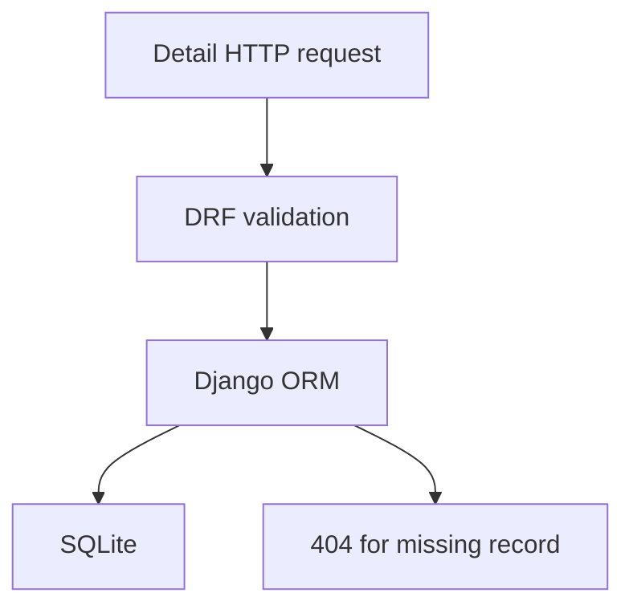

# Blog Post API
A small Django REST Framework learning project with blog detail read, update and delete endpoints. This repair preserves the existing `/blogposts/{id}/` route and fixes missing-object errors and validation regressions. It is not a complete production publishing platform.

```bash
python3.12 -m venv .venv
. .venv/bin/activate
pip install -r requirements.lock
export DJANGO_SECRET_KEY="$(python -c 'import secrets; print(secrets.token_urlsafe(48))')"
python mysite/manage.py migrate
python mysite/manage.py test api
python mysite/manage.py runserver
```
`DJANGO_DEBUG` defaults to false. Set it explicitly for local debugging. Configure `DJANGO_ALLOWED_HOSTS` as a comma-separated list. Existing routes remain unauthenticated to preserve tutorial behavior; add authentication/authorization before any public deployment. A tracked historical SQLite database and Python bytecode remain in upstream history; this patch does not delete user data. Do not publish the existing database. Docker should mount a new database and provide a random DJANGO_SECRET_KEY.


